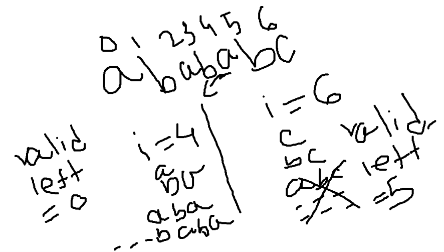

- this is slinding window + two pointers problem
- main idea how many valid range end at each index
- let say i = 2, [2,2], [1,2], [0,2] are valid
- just choose the left index carefully if you get abc then valide left index is  start from b.
 
